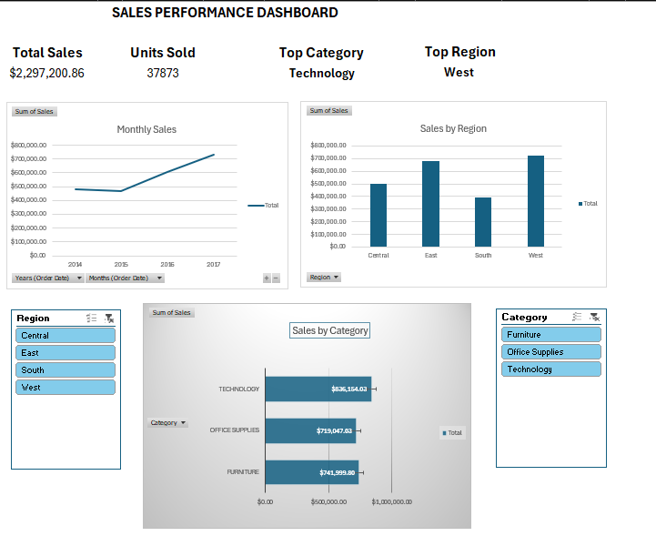

# Sales Performance Dashboard Using Excel

## Project Overview
This project analyzes Superstore sales data using Microsoft Excel to identify sales trends and business performance insights.

## Objectives
- Analyze total sales and quantity sold
- Compare sales performance across product categories and regions
- Evaluate yearly sales trends
- Analyze monthly sales performance
- Calculate month-over-month (MoM) and year-over-year (YoY) changes

## Tools Used
- Microsoft Excel
- Excel Tables and formulas
- PivotTables
- Charts and data visualization

## Workbook Structure
- **Raw_Data:** Original dataset
- **Clean_Data:** Prepared data for analysis
- **Analysis:** Sales calculations, summaries, and trends
- **Dashboard:** Visual summary of key performance indicators and sales insights

## Key Findings
- Total Sales: $2,297,200.86
- Total Quantity Sold: 37,873
- Highest-Selling Category: Technology
- Highest-Selling Region: West
- Highest Sales Year: 2017

## Skills Demonstrated
Data cleaning, spreadsheet formulas, PivotTable analysis, trend analysis, and dashboard development.

## Dashboard Preview

